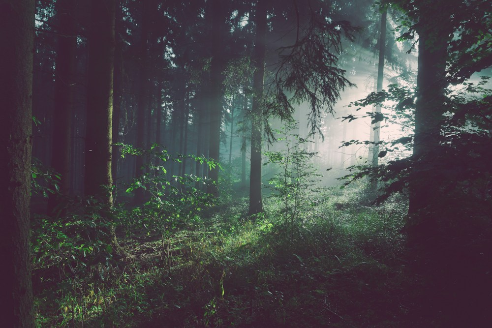

# 森の呼吸に、歩幅を合わせて。

- id: b walk
- order: 60
- area: 江別・野幌
- category: 自然
- minutes: 75

- access_minutes: 45

## 写真

## 紹介
身近な森で、音と香りを探す小さな冒険。

## ストーリー
木漏れ日の揺れ、足元の葉の音。遠くへ行かなくても、いつもと違う速さで歩くだけで発見があります。

## 意外な魅力
小さな観察を目的にすると、短い散歩も旅になります。

## 写真の出典
[既存モックで使用しているイメージ写真](https://images.unsplash.com/photo-1448375240586-882707db888b?auto=format&fit=crop&w=1000&q=85)
