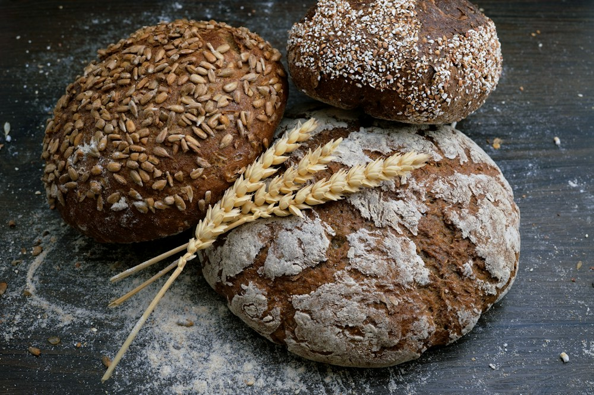

# 焼きたての香りを、旅の目的に。

- id: bread
- order: 70
- area: 札幌
- category: 食
- minutes: 60

- access_minutes: 15

## 写真

## 紹介
パンと街歩きで、いつもの街を再発見する。

## ストーリー
朝の街で、お気に入りの一品を探す。近くの公園で食べるだけでも、いつもと違う休日の始まりです。

## 意外な魅力
店舗や商品を指定しない、サンプルの旅のアイデアです。

## 写真の出典
[既存モックで使用しているイメージ写真](https://images.unsplash.com/photo-1509440159596-0249088772ff?auto=format&fit=crop&w=1000&q=85)
