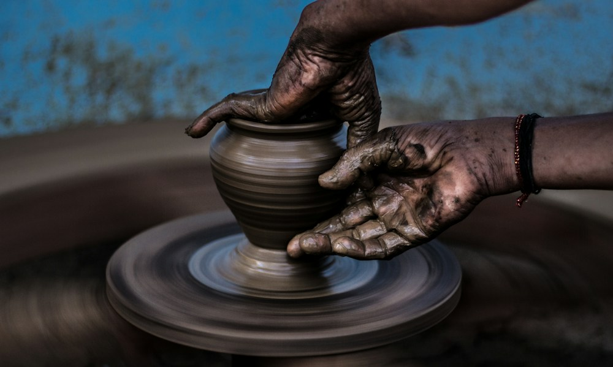

# 手を動かすと、旅が形になる。

- id: craft
- order: 50
- area: 小樽
- category: ものづくり
- minutes: 90

- access_minutes: 60

## 写真

## 紹介
ガラスの光や職人の仕事に触れる旅のアイデア。

## ストーリー
透明な素材に映る色と光。作る過程を知ると、お土産選びにも新しい視点が生まれます。

## 意外な魅力
制作・見学プログラムは未確認の体験例です。予約や開催状況は別途確認が必要です。

## 写真の出典
[既存モックで使用しているイメージ写真](https://images.unsplash.com/photo-1493106641515-6b5631de4bb9?auto=format&fit=crop&w=1000&q=85)
