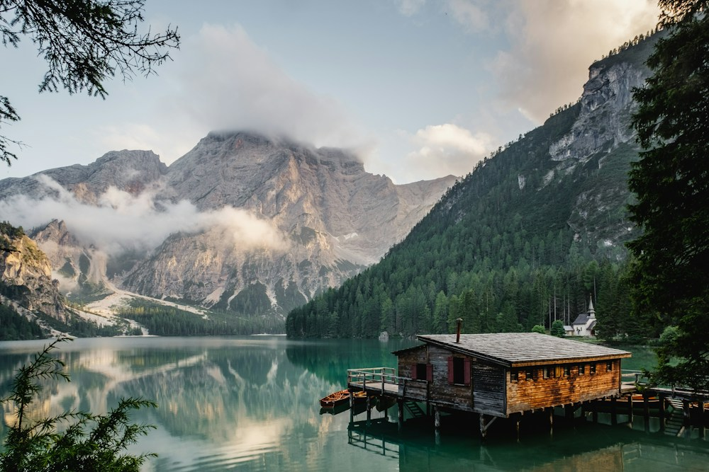

# 空の広さを、思い出す。

- id: hill
- order: 80
- area: 美瑛
- category: 絶景
- minutes: 60

- access_minutes: 240

## 写真

## 紹介
丘の稜線と雲の影を眺める時間。

## ストーリー
畑の色、道の曲線、流れる雲。移り変わる光を待つことも、この土地ならではの過ごし方です。

## 意外な魅力
畑は私有地です。公道や指定の展望場所から眺める想定です。

## 写真の出典
[既存モックで使用しているイメージ写真](https://images.unsplash.com/photo-1470770841072-f978cf4d019e?auto=format&fit=crop&w=1000&q=85)
