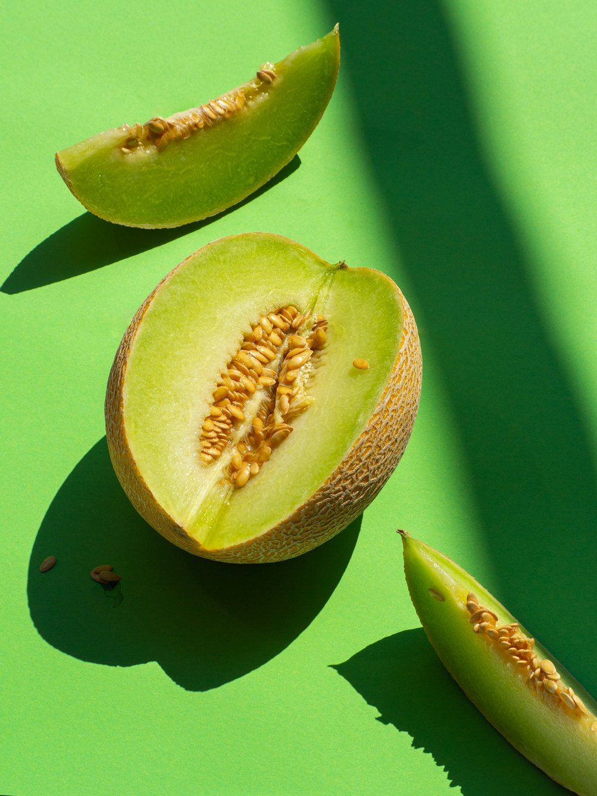

# ひとくちの甘さに、土地の物語。

- id: melon
- order: 10
- area: 夕張
- category: 食
- minutes: 60

- access_minutes: 120

## 写真

## 紹介
夕張メロンを入口に、育てる人と土地に思いを巡らせる。

## ストーリー
短い夏の光と、毎日の手仕事。その積み重ねが、一玉の香りになります。直売所を巡る旅を想像してみませんか。

## 意外な魅力
畑の風景を知ると、いつものひとくちが少し変わるかもしれません。農園見学・試食は未確認の体験例です。

## 写真の出典
[既存モックで使用しているイメージ写真](https://images.unsplash.com/photo-1571575173700-afb9492e6a50?auto=format&fit=crop&w=1000&q=85)
