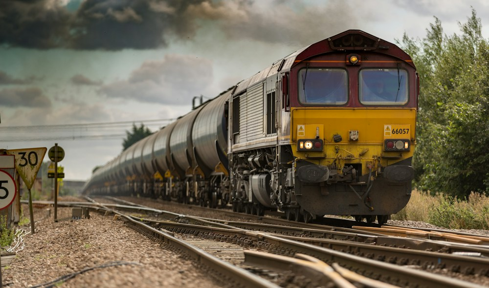

# 線路の向こうに、開拓の物語。

- id: rail
- order: 100
- area: 三笠
- category: 歴史
- minutes: 90

- access_minutes: 110

## 写真

## 紹介
鉄道と炭鉱のつながりを知る旅。

## ストーリー
運ばれたのは石炭だけではなく、人と文化も。鉄道の記憶をたどると、北海道の街がつながって見えてきます。

## 意外な魅力
施設の見学・乗車体験は未確認のサンプルです。

## 写真の出典
[既存モックで使用しているイメージ写真](https://images.unsplash.com/photo-1474487548417-781cb71495f3?auto=format&fit=crop&w=1000&q=85)
