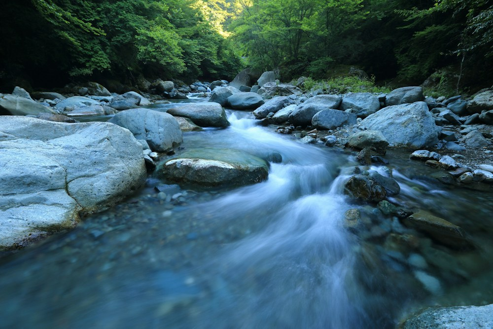

# 川のそばに、何もしない時間を。

- id: river
- order: 90
- area: 千歳
- category: 自然
- minutes: 60

- access_minutes: 70

## 写真

## 紹介
水の音を聞きながら、気持ちをほどく。

## ストーリー
透明な流れを目で追いかける。予定を詰めずに立ち止まる時間が、旅の記憶になるかもしれません。

## 意外な魅力
水辺の遊歩道を歩く想定。アクティビティ提供を保証するものではありません。

## 写真の出典
[既存モックで使用しているイメージ写真](https://images.unsplash.com/photo-1437482078695-73f5ca6c96e2?auto=format&fit=crop&w=1000&q=85)
